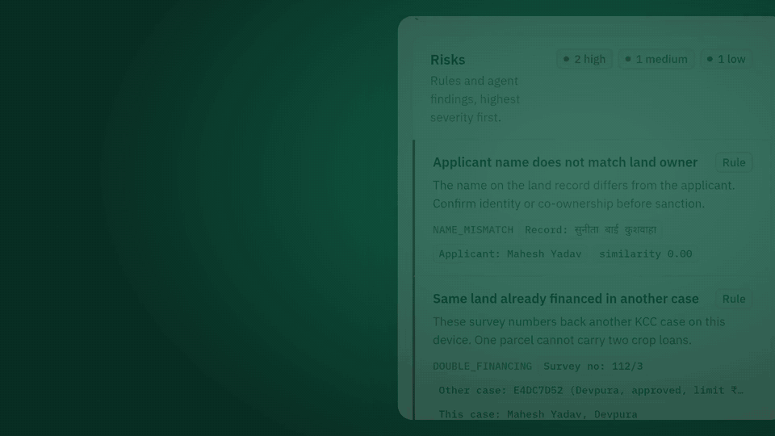
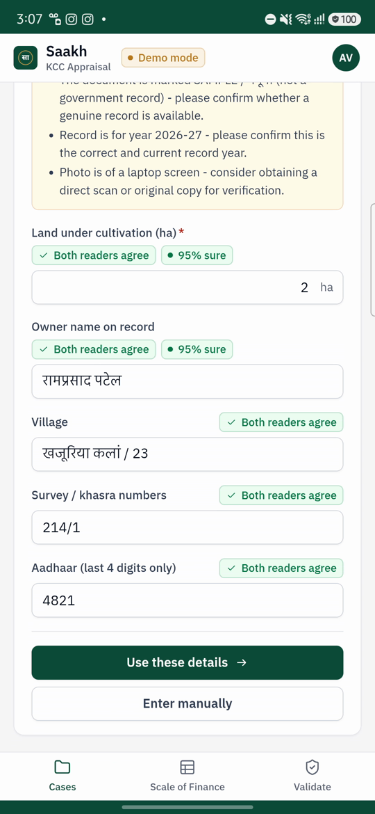
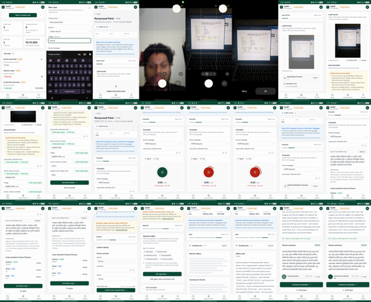
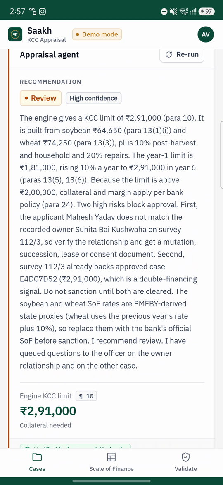
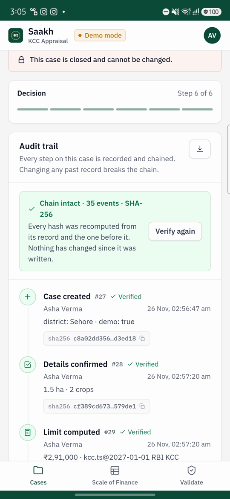
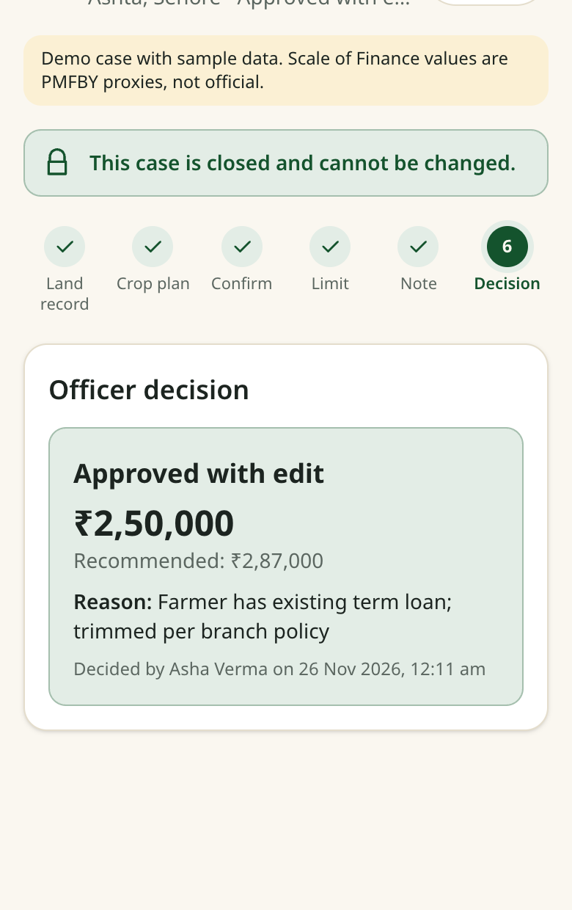
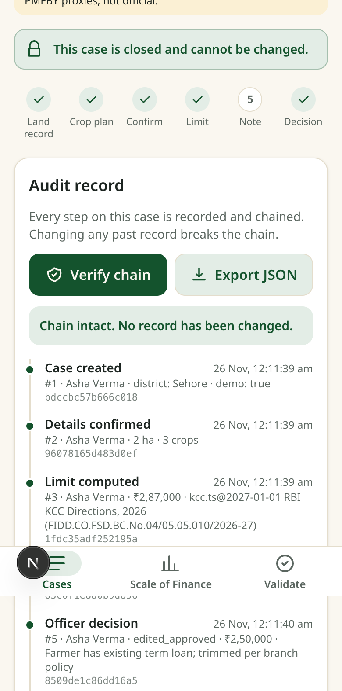
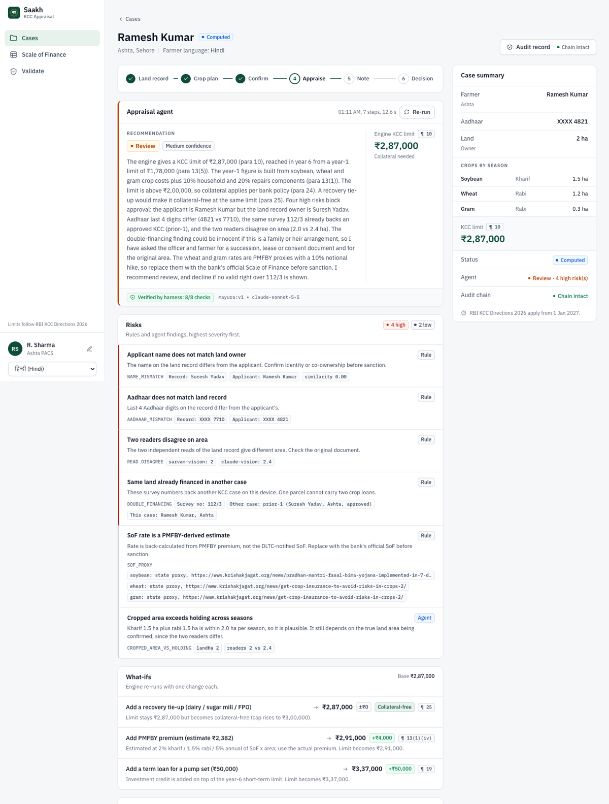
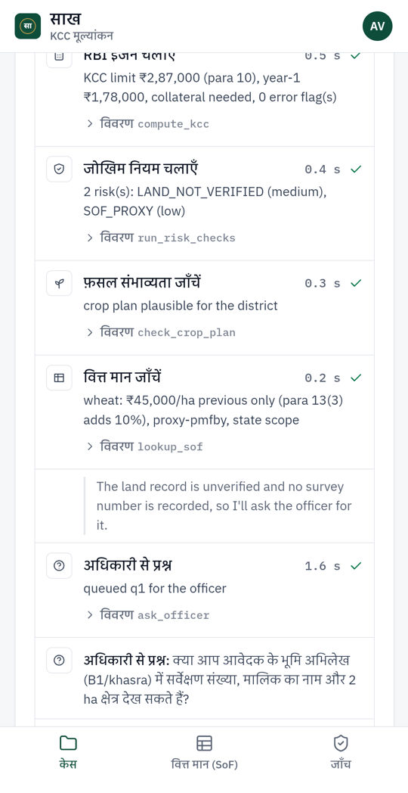
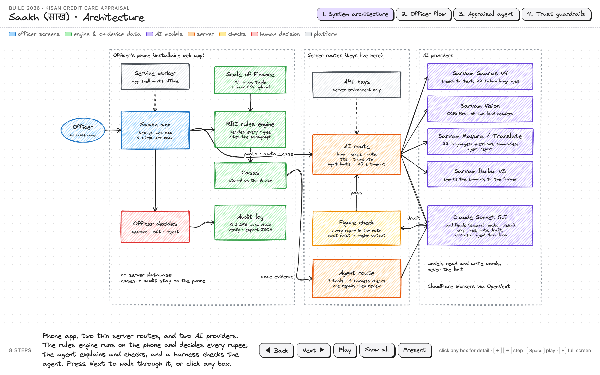

# Saakh (साख)

**KCC loan appraisal for cooperative bank officers, on a phone, under the RBI KCC Directions, 2026.**

[Live app](https://saakh.komalvardhan.com) · [Demo video](https://github.com/KomalSrinivasan/saakh/raw/main/docs/media/saakh-demo.mp4) · [Architecture](docs/architecture.html) · [Impact case](docs/impact-case.md) · Built for BUILD 2036 (TiE Global Summit 2026 x Hack2skill)

[](https://github.com/KomalSrinivasan/saakh/raw/main/docs/media/saakh-demo.mp4)

**[Watch the full 1:41 demo (MP4)](https://github.com/KomalSrinivasan/saakh/raw/main/docs/media/saakh-demo.mp4)** · [24-second teaser](https://github.com/KomalSrinivasan/saakh/raw/main/docs/media/saakh-teaser.mp4). Recorded on a Samsung Android phone against the live site.

Saakh means credit, or trust, in Hindi. Today a cooperative bank, RRB or PACS officer appraising a Kisan Credit Card loan copies the land record by hand, looks up the Scale of Finance, works out six years of limits and writes the sanction note. The RBI KCC Directions, 2026 (issued 19 Jun 2026, for loans sanctioned from 1 Jan 2027) apply to all of these lenders, so each of them has to recompute limits the new way.

With Saakh, the officer photographs the land record and the farmer describes the crop plan in their own language. AI reads both and fills in fields the officer confirms. A deterministic rules engine on the phone computes every rupee and tags each step with its RBI paragraph. An appraisal agent checks the case for risks such as double financing, tries what-if changes and writes a recommendation. A set of deterministic checks verifies that report before the officer sees it. The officer gets a sanction note, plays a spoken summary to the farmer in the farmer's language, and decides. Every step goes into a hash-chained audit log.

The rule behind all of it: **AI handles words. The engine handles numbers. The officer decides.**

## Try it in two minutes

1. Open https://saakh.komalvardhan.com on a phone or desktop. On Android, tap **Install app** to add it to the home screen.
2. Enter any officer name and choose **Demo mode**. Three fictional farmers load, with sample land records and voice clips.
3. Follow **How Saakh works** on the home screen. Step 4 opens Mahesh Yadav's case. Tap **Confirm and compute limit**, then **Run appraisal**. In about 12 seconds the agent flags a name mismatch and a survey number that already backs an approved loan, and recommends Review.
4. Draft the sanction note, play the farmer summary, then approve, edit or reject. Open **Audit record** and tap **Verify chain**.
5. Open **Validate** to run the 19 RBI calculation cases on your own device.

**Real mode** starts empty. Photograph your own land record and speak the crop plan into the phone.

## Where it fits

NABARD's e-KCC portal and the e-PACS ERP already digitise the loan application and the society's ledger. Saakh adds the step they leave to the officer: appraising the case to the 2026 Directions, explaining it to the farmer, and leaving a record an inspector can check. Once a bank has access to land-record APIs such as RBIH's platform, those replace the photo step. Landscape and business model: [docs/impact-case.md](docs/impact-case.md#where-saakh-fits).

## Screenshots

On a Samsung phone, against the live site:

| Land record, two readers agree | Crop plan spoken in Marathi | Agent recommends Review | Audit chain verified |
|---|---|---|---|
|  |  |  |  |

On desktop:

| Home and guided demo | Limit with RBI paragraphs | Officer decision | Audit chain verified | Validation pack |
|---|---|---|---|---|
|  |  |  |  |  |

| Agent on a suspicious case | Agent report, 8/8 checks | Hindi run on an Android phone |
|---|---|---|
|  |  |  |

## What it does

| Feature | Detail |
|---|---|
| Land record reading | Photo of a khasra, B1, khatauni, 7-12, pahani or patta. Two readers run in parallel: Sarvam Vision OCR followed by Claude structuring, and Claude vision on the photo. Each field shows whether both readers agree. Acre and bigha convert to hectares. Aadhaar is cut to the last 4 digits. |
| Crop plan by voice | The farmer speaks in any of 22 Indian languages or English (Sarvam Saaras v4). Claude maps local crop names like chana or sarson to Scale of Finance crops and asks follow-ups when area or season is missing. |
| Cited limit | Year 1 to year 6 short-term limits, the KCC limit, collateral position, Flexi KCC and tenancy-proof checks. Each line shows its RBI paragraph. |
| Appraisal agent | Claude Sonnet 5.5 runs a tool loop over 7 deterministic tools and streams its trace to the screen. It recommends approve, review or decline, lists risks, and asks the officer questions when the evidence cannot settle something. The officer answers and re-runs it. |
| Risk checks | 17 deterministic rules, including name mismatch across Devanagari and Latin spellings, Aadhaar mismatch, the same survey number backing another case, cropped area over the holding, implausible crop for the season or district, proxy or missing Scale of Finance, and tenancy documents. |
| What-ifs | The engine re-runs with one change each: a recovery tie-up, the smallest cut that brings the limit under ₹2 lakh, a pump-set term loan, the PMFBY premium, or dropping crops with no Scale of Finance. |
| Harness | 8 checks run on every agent report: every rupee came from a tool, the result is the engine's output, no approve over an engine error or a high risk, no rule finding dropped, decline has a reason, summary present, required tools ran. One repair turn, then the report is downgraded to review. |
| Sanction note | Drafted in the officer's language and streamed, so text appears in about 1.5 s. Every rupee figure is checked against the engine output before the officer can copy or act on it. |
| Farmer summary | Translated into the farmer's language and read aloud with Sarvam Bulbul v3. |
| Officer decision | Approve, edit or reject. Edit and reject need a written reason. A decided case is locked. |
| Audit log | SHA-256 hash chain on the device. Every agent run is logged with its recommendation, checks passed, risk codes and models. "Verify chain" shows the first changed record. Export as JSON. |
| Scale of Finance | Bundled estimates for 5 MP districts, back-calculated from public PMFBY data and flagged "Estimate" everywhere. A bank uploads its official table as CSV. |
| Validation pack | `/validate` runs 19 hand-computed RBI cases, 10 land-record samples and one crop plan in 13 languages. |
| Demo and Real mode | Chosen at first run, switchable any time. Demo mode loads three sample farmers (a clean case, an approved case, and a suspicious one that triggers double financing and a name mismatch), sample land records and voice clips, and a six-step "How Saakh works" walkthrough. Real mode has nothing pre-filled and nothing sample. Switching never deletes cases. |
| Install as an app | "Install app" button on Android and desktop Chrome, an Add to Home Screen hint on iPhone. The service worker caches the app shell so it opens offline, and drafts stay on the device if the network drops. |

## Languages

| What | Coverage |
|---|---|
| Farmer speech in | 22 Indian languages and English (Saaras v4) |
| Text translation | 22 Indian languages (Mayura for 11, Sarvam-Translate for the rest) |
| Voice output and UI | 11 languages |

Right-to-left scripts (Urdu, Kashmiri, Sindhi) render per paragraph, so mixed Urdu and English text reads in the right direction.

## Built with

| Layer | What |
|---|---|
| App | Next.js 16 (App Router), React 19, TypeScript, Tailwind CSS 4, installable PWA with a service worker |
| Rules engine | Plain TypeScript in `src/lib/kcc.ts`. Runs on the device with no network or model calls. |
| Agent | Vercel AI SDK v7 `ToolLoopAgent` with Claude Sonnet 5.5, 7 deterministic tools, streamed trace |
| Reading and drafting | Claude Sonnet 5.5 and Haiku 5.5 (land-record structuring, crop mapping, sanction note) |
| Indian languages | Sarvam: Saaras v4 speech-to-text, Vision OCR, Mayura and Sarvam-Translate, Bulbul v3 text-to-speech |
| Storage | Browser local storage for cases and the SHA-256 audit chain. No server database. |
| Hosting | Cloudflare Workers through OpenNext, at https://saakh.komalvardhan.com |
| Tests | `node:test` with 94 unit tests, plus the in-app validation pack |

## Architecture



The interactive version is [docs/architecture.html](docs/architecture.html). It is one offline file with four tabs (system architecture, officer flow, appraisal agent, trust guardrails) and a step-by-step walkthrough. Static images of each tab: [system](docs/architecture-system.png), [officer flow](docs/architecture-flow.png), [appraisal agent](docs/architecture-agent.png), [trust guardrails](docs/architecture-trust.png).

## How it works

1. The officer opens a case and photographs the land record. The phone sends the image to `/api/ai/land`. Two readers run in parallel: Sarvam Vision OCR with Claude structuring the text, and Claude vision on the photo. Saakh reconciles the two field by field. Where they disagree, the field is marked and the agent later raises a `READ_DISAGREE` risk.
2. The farmer speaks the crop plan. `/api/ai/crops` transcribes it with Saaras v4 and has Claude turn it into crop lines (crop, season, area). If a season claims more land than the record shows, Saakh asks instead of accepting it.
3. The officer confirms or edits every field. Nothing reaches the engine before this.
4. `src/lib/kcc.ts` computes the limits on the device. It is pure TypeScript with no network calls and no model calls.
5. `/api/agent` runs the appraisal agent (Vercel AI SDK v7 `ToolLoopAgent`, Claude Sonnet 5.5). Its tools are `lookup_sof`, `compute_kcc`, `run_risk_checks`, `check_crop_plan`, `what_if`, `ask_officer` and `finish`. The tools take the case evidence only, so the model cannot pass a number in. The trace streams to the screen as it runs.
6. The harness (`src/lib/harness.ts`) verifies the report. The result, the what-ifs and the rule risks in the report come from tool outputs, not from the model. If a check fails, the agent gets one repair turn. If it still fails, the recommendation becomes review and the summary is replaced with a template.
7. The agent writes in English. After the harness passes, Sarvam translates the summary, risks and what-ifs into the officer's language. A translation is kept only if it contains the same set of numbers as the English text. Otherwise the English is shown. Questions for the officer are also given in the farmer's language with read-aloud.
8. `/api/ai/note` drafts the sanction note from the engine result. Any rupee figure the engine did not produce triggers one redraft, then a refusal. The farmer summary is translated and spoken.
9. The officer decides. Every step, including each AI call, each agent run and the models that served them, is appended to the audit chain. Agent runs record the recommendation, checks passed, risk codes and models, not the raw evidence.

API keys live only on the server. Cases and the audit log live in the browser's local storage. There is no server database. The app runs on Cloudflare Workers through OpenNext.

### Example: a constructed fraud case

I built a case where the applicant's name differs from the owner on the land record and the survey number already backs an approved case on the device. The agent returns Review with two high risks, `NAME_MISMATCH` and `DOUBLE_FINANCING`, and the harness passes 8 of 8 checks. A run takes about 12 seconds on the live deployment.

## Quick start

Needs Node 26 and pnpm 10.

```bash
pnpm i
```

Create `.env.local` in the repo root:

```bash
SARVAM_API_KEY=your-sarvam-key
ANTHROPIC_API_KEY=your-anthropic-key
# optional, only for keys not scoped to a workspace
ANTHROPIC_WORKSPACE_ID=
```

Run it:

```bash
pnpm dev     # http://localhost:3000
pnpm test    # 94 unit tests: engine, SoF, audit, storage, validation, AI helpers, risk, harness, agent loop
```

Without keys the app still runs. The engine, risk rules, what-ifs, audit log, Scale of Finance page and calculation part of the validation pack work offline, and every AI step offers manual entry. The agent needs the Anthropic key.

In the app, Demo mode loads these samples for you. Sample inputs are in `public/samples/`: `khasra-1.jpg` to `khasra-10.jpg`, `crop-plan-<hi|en|mr|gu|te|ta>.wav`, `crop-plans.json` and `sof-sehore.csv`. The full test walkthrough is in [specs/001-kcc-appraisal-agent/quickstart.md](specs/001-kcc-appraisal-agent/quickstart.md).

## Testing status

| Check | Result |
|---|---|
| Unit tests (`pnpm test`) | 94 / 94 pass |
| Calculation, 19 hand-computed RBI cases | 19 / 19 pass, on device |
| Land-record extraction, 10 synthetic records | 10 / 10 pass on the live deployment |
| Language parity, one crop plan in 13 languages | 13 / 13 pass on the live deployment |
| Real Android phone (Samsung, Chrome) | Demo and real mode, camera, microphone, compute, agent on the suspicious case (8/8 checks), sanction note, spoken farmer summary, decision and install as an app work end to end |

Parity covers Hindi, English, Marathi, Gujarati, Telugu, Tamil, Bengali, Kannada, Malayalam, Odia, Punjabi, Urdu and Assamese. The last seven transcripts were machine-translated with Sarvam from an English plan that writes areas as numerals. They are not from native speakers.

On the phone, install works: Android builds a real app from it and it opens full screen. The camera and microphone work too. A photo of a khasra shown on a laptop screen was read correctly by both readers, and a Marathi crop plan played through laptop speakers and recorded on the phone came back as a word-perfect transcript with all three crops mapped. The farmer summary plays aloud in Marathi.

## Project structure

```text
src/
  app/
    page.tsx                 case list, new case, demo walkthrough
    case/[id]/page.tsx       land -> crops -> confirm -> limit + agent -> note -> decision
    sof/page.tsx             Scale of Finance table and CSV upload
    validate/page.tsx        validation pack
    api/ai/[action]/route.ts land | crops | note | tts | translate (server, holds keys)
    api/agent/route.ts       appraisal agent, streams its trace
  components/
    case/                    capture, result, agent, risk, what-if, note/decision and audit panels
    how-it-works.tsx         six-step demo walkthrough
    install.tsx              install-app button and iPhone hint
  lib/
    kcc.ts                   RBI rules engine
    risk.ts                  17 deterministic risk rules
    names.ts                 transliteration + Jaro-Winkler name matching
    reconcile.ts             merges the two land-record reads
    whatif.ts                one-change engine re-runs
    harness.ts               verifiers for the agent report
    agent/                   tool loop, tools, model, client
    audit.ts                 hash-chained audit log
    ai.ts, ai-pure.ts        Sarvam + Claude calls, figure check, Aadhaar masking
    note-stream.ts           streamed sanction note with figure verification
    demo.ts                  demo-mode sample farmers
    sof.ts                   Scale of Finance table, CSV parsing
    store.ts, i18n.ts        on-device storage, UI languages
    validation.ts            validation pack runner
  data/
    sof-mp.json              MP proxy Scale of Finance (labelled)
    agronomy-mp.json         indicative crop calendar and district belts
    validation-set.json      calc cases, extraction and parity sets, open interpretations
    ui/*.json                UI copy per language
public/
  sw.js                      app-shell service worker
  samples/                   synthetic land records, crop-plan audio, sample SoF CSV
specs/001-kcc-appraisal-agent/  spec, plan, research, data model, API contract, tasks
docs/                        architecture diagram, impact case, screenshots, demo video
```

## RBI paragraphs implemented

All references are to the RBI KCC Directions, 2026 (FIDD.CO.FSD.BC.No.04/05.05.010/2026-27).

| Para | Rule in the engine |
|---|---|
| 6(5) | Land of 1 ha or less marks a marginal farmer |
| 8 | Six-year KCC tenure |
| 10 | KCC limit = year-6 short-term limit + long-term limit |
| 13(1)(i) | Scale of Finance x area, per crop |
| 13(1)(ii) | +10% for post-harvest and household consumption |
| 13(1)(iii) | +20% for repairs, maintenance and tech services |
| 13(1)(iv) | + crop insurance premium |
| 13(3) | SoF not yet notified: previous SoF + 10% |
| 13(4) | Crop with no SoF is outside KCC, flagged |
| 13(5) | Round to the nearest ₹1,000 |
| 13(6) | +10% each year for six years |
| 13(7) | Flexi KCC of ₹10,000 to ₹50,000 for marginal farmers |
| 19 | Long-term (investment) limit |
| 23, 24 | Collateral-free up to ₹2,00,000, above that per bank policy |
| 25 | Collateral-free up to ₹3,00,000 with a recovery tie-up |
| 29 | Area per season cannot exceed land on record |
| 30 | Tenant proof: self-affidavit up to ₹50,000, local administration or panchayat certificate above |

Three readings of the text are not settled yet and are listed in the validation pack: the rounding order in the Annex I illustrations, whether thresholds are compared after rounding, and whether the para 30 cap applies to the full limit including the term loan.

## Data honesty

The Scale of Finance values bundled for Indore, Sehore, Ujjain, Dewas and Dhar are not official. Official MP 2026-27 tables were not available in machine-readable form, so I used PMFBY sum insured per hectare as a proxy. 28 of the 35 rows are state-level estimates because no district figure was found. Every row carries its source and the app labels it "Estimate" on every screen. A bank should upload its official table before relying on any figure. `public/samples/sof-sehore.csv` is sample data for testing the upload, not a real DLTC table.

The crop calendar and district belts behind the plausibility rules are indicative. Only cotton, garlic, summer moong and soybean were checked against district sources. A plausibility flag asks the officer to look again. It never changes a limit.

All land records, voices and farmers in the samples are synthetic.

## Hosting limits

The demo runs on the Cloudflare Workers free plan, which caps CPU time per request at 10 ms. Most pages stay well under it, but an agent run uses around 220 ms of CPU. Cloudflare has let every request through so far. If you see error 1102, retry once.

## License

MIT
